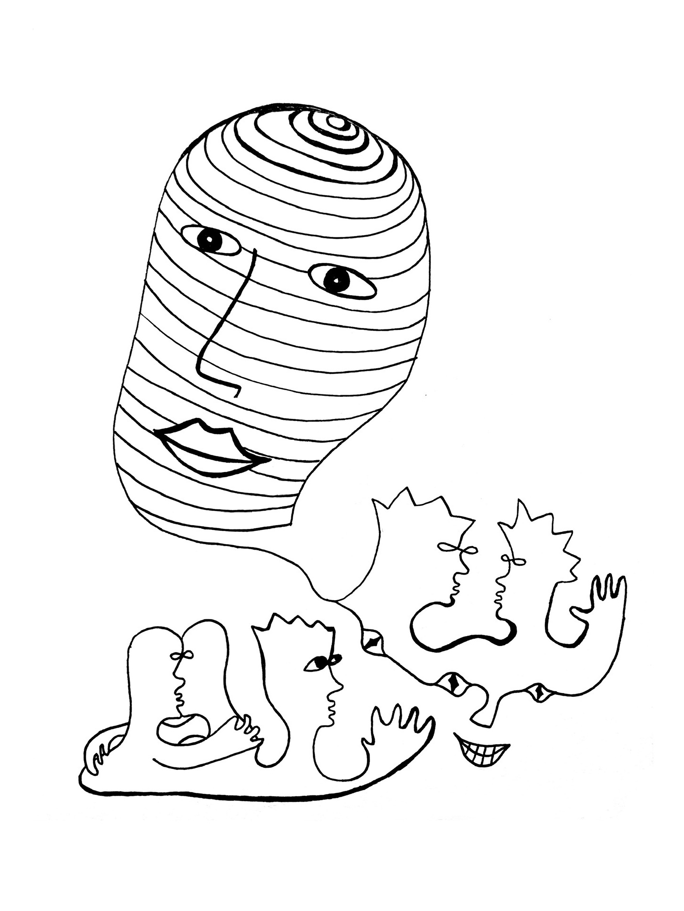

Argentiinassa teimme matkan Cordobaan. Kolmikon muodostivat German Uruguaysta, Nacho Meksikosta ja minä. Aasi tulee aina luettelossa viimeisenä, opetetaan Chilessä.

Asunto sijaitsi hieman hämärällä alueella, mutta se palveli tarpeitamme erinomaisesti. Kaupunki oli eloisa ja sopivan pieni. Suunnittelimme tekemistä, mutta kohtasimme valitsemisen vaikeuden. Piirsin ajatuksia, selkeyttääkseni.

Vaihtoehtojen runsaus tuotti positiivisen ongelman, jonka kanssa kamppailimme koko viikonlopun.
