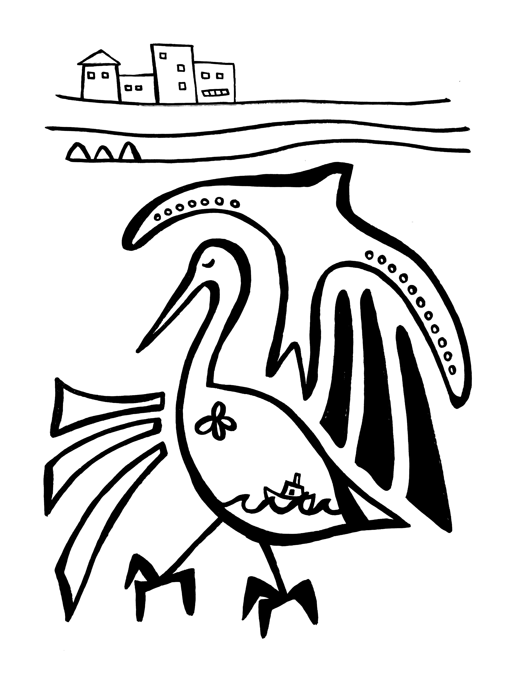

Kirjoittelen tässä nyt testiksi, päivitän nettisivun toimintaperiaatetta. 

Pienenä olin aktiivinen lintubongari. Pitkäksi aikaa asia unohtui kokonaan. Nykyään on kuitenkin joitakin lintuja, jotka herättävät lämpimiä ja haikeita tunteita.

Lempilintuni on tervapääsky, kesän tuoja. Ne vanhempieni talon yllä julistavat kesän lopullisesti alkaneeksi. 

Toinen on pelikaani. Ylväs ja vakaa lentäjä. Rannoilla auringossa paistatteleva. Tuovat mieleen Chilen.
